# Mikrotik IKEv2 IPsec with Self-Signed Certificate

- MikroTik is the CA

- MikroTik is the IKEv2 server

- Many users

- Each user has their own certificate

- Disable one user by disabling that user's IPsec identity

```markdown
                    INTERNET
                       |
                       |
                  MikroTik
              IKEv2 Server + CA
                       |
          +------------+------------+
          |            |            |
       IT-L06        IT-L07       IT-L08
      Certificate   Certificate   Certificate
      10.250.10.x   10.250.10.x   10.250.10.x
```

## Create CA Certificate

```routeros
/certificate
add name=cert-mikrotik-ca \
    common-name=cert-mikrotik-ca \
    key-usage=key-cert-sign,crl-sign,digital-signature,key-encipherment,data-encipherment \
    trusted=yes \
    subject-alt-name=DNS:cert-mikrotik-ca
```

### Sign the cert CA

```routeros
/certificate sign cert-mikrotik-ca
```

### Mark CA as trusted

```routeros
/certificate set trusted=yes cert-mikrotik-ca
```

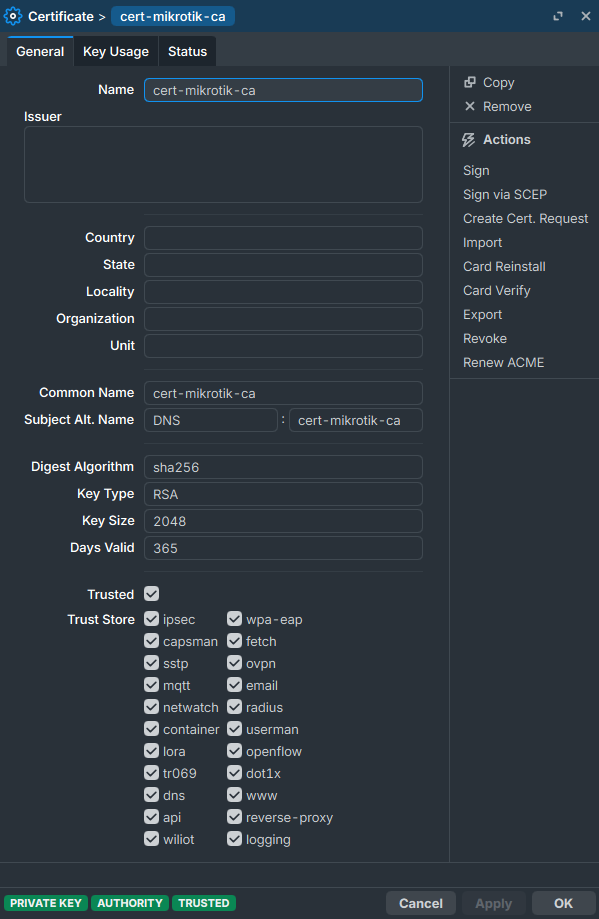
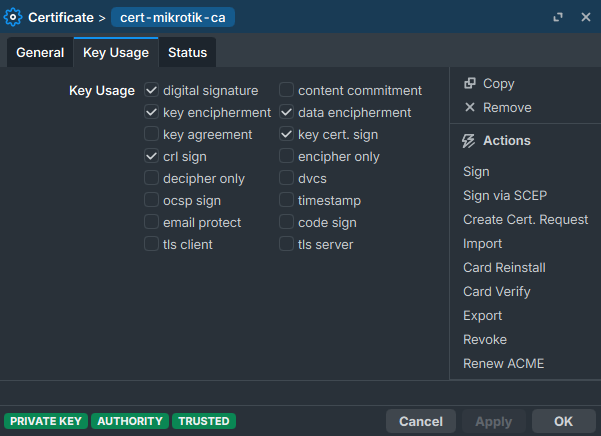

## Use mikrotik router public dns name or public ip

```routeros
/ip cloud print
```

- print detail will be:

> public-address: 111.111.111.111
>
> dns-name: d8550dd96e2a.sn.mynetname.net

## Create Server Certificate

```routeros
/certificate
    add name=cert-server \
    common-name=d8550dd96e2a.sn.mynetname.net \
    subject-alt-name=DNS:d8550dd96e2a.sn.mynetname.net \
    key-usage=digital-signature,tls-server
```

### Sign the cert Server

```routeros
/certificate sign cert-server ca=cert-mikrotik-ca
```

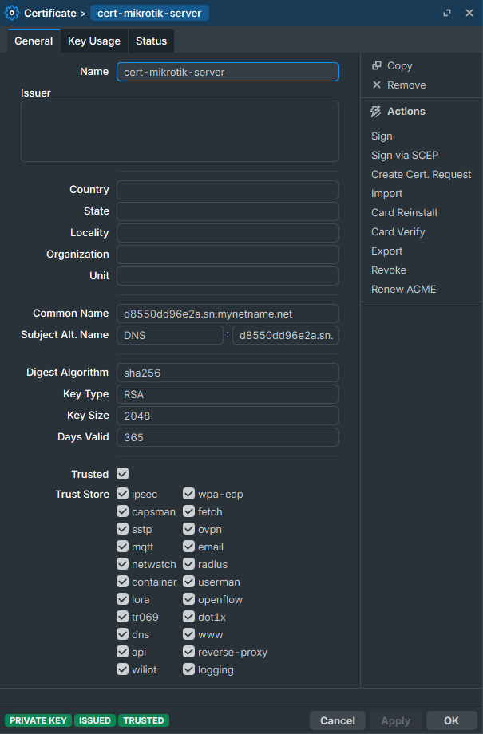
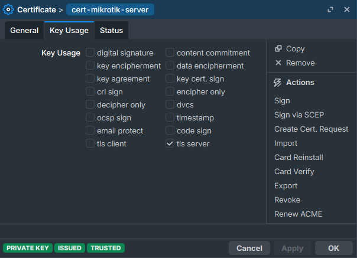

### Set trusted the server

```routeros
/certificate set cert-server trusted=yes
```

## Create the first user certificate

```routeros
/certificate
add name=chanpiseth-IT-L06 \
    common-name=chanpiseth-IT-L06 \
    key-usage=digital-signature,tls-client \
    subject-alt-name=DNS:chanpiseth-IT-L06
```

### Sign the user certificate

```routeros
/certificate sign chanpiseth-IT-L06 ca=cert-mikrotik-ca
```

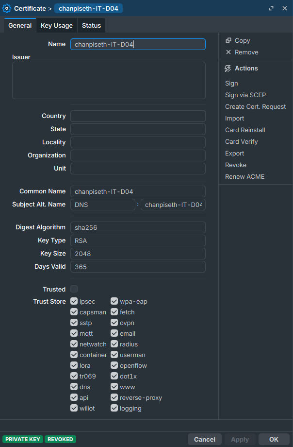
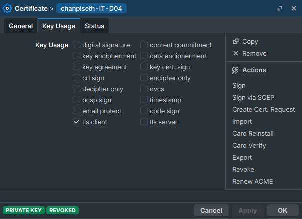

## Then create many more users

```markdown
    IKEv2-CA
    |
    +-- Server certificate
    |
    +-- chanpiseth-IT-L06
    +-- IT-L07
    +-- IT-L08
    +-- IT-L09
    +-- IT-L10
```

## Export certificates for users Windows

```routeros
/certificate
export-certificate cert-mikrotik-ca type=pem

/certificate
export-certificate chanpiseth-IT-L06 type=pkcs12 export-passphrase="YourStrongPassword"
```

Then copy to user computer to install.

- **Give each user only their own .p12/.pfx file**
- **Do NOT give users the CA private key**
- **The CA certificate can be distributed to clients as a trusted CA certificate**

## install download CA to computer trusted root certification authorities

- CA File: Install cert_export_cert-mikrotik-CA.crt on the client device and mark it as trusted (e.g., iOS Settings > General > About > Certificate Trust Settings).

Right click to install the certificate CA to machine

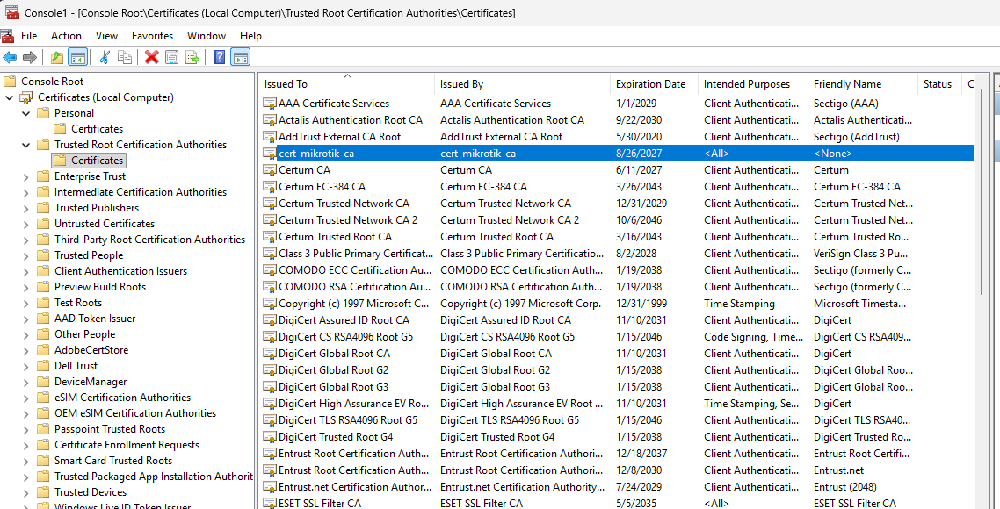

## install download user certificate to computer personal certificate

- Client File: Install cert_export_chanpiseth-IT-D04.p12 on the client device (e.g., Windows, Android, iOS).

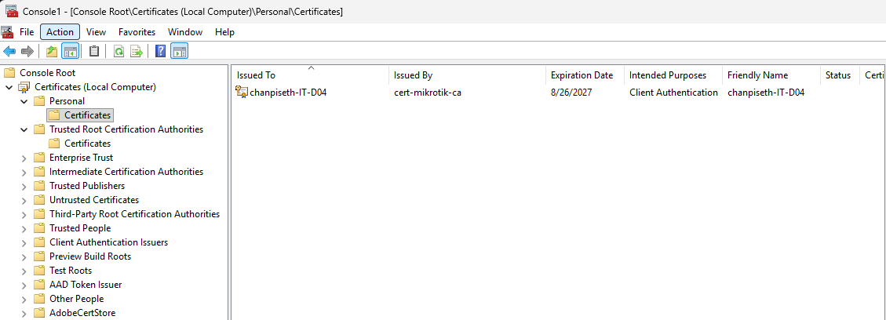

To open MMC:

1. windows search or Ctrl + R and type MMC
2. File → add/remove snap-in...
3. Select → certificates Add > → Computer account → Next → Finish

**Note:**

- **after install the two cert open or search `MMC` to check verify the install certificate and remove the old expired certificate from the computer.**
- **if the old is remain in the computer, the new certificate will not work.**
- **Remove the copy file certificate from computer for protect from leak and security.**

## Create the Windows IKEv2 VPN

- Settings
  → Network & Internet
  → VPN
  → Add VPN

### Add VPN Connection

- VPN provider:

```markdown
Windows (built-in)
```

- Connection name:

```markdown
TEM IKEv2 VPN
```

- Server name or address:

```markdown
d8550dd96e2a.sn.mynetname.net
```

- VPN type:

```markdown
IKEv2
```

- Type of sign-in info:

```markdown
Certificate
```

- User name:

```markdown
leave blank
```

- Password:

```markdown
leave blank
```

> → Click Save

## Important Windows certificate selection

- Open Control Panel
  → Network and Internet
  → Network Connections

### Right-click your VPN

- TEM IKEv2
  → Properties
  → Security

### You should have

- Type of VPN:

```markdown
IKEv2
```

- Data encryption:

```markdown
Maximum strength encryption

[✓] use machine certificate
```

> → Tick use machine certificate then save

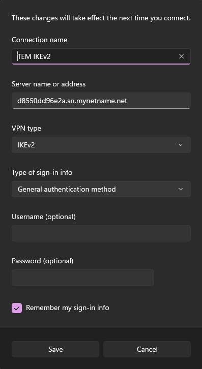
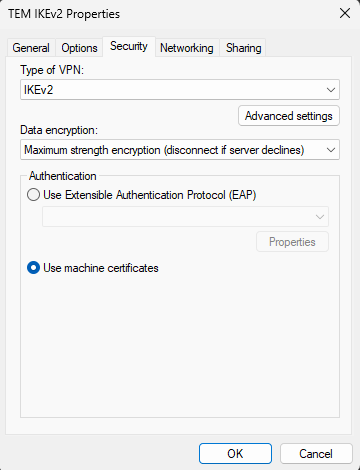

## MikroTik server certificate should have Server Authentication

```markdown
                    IKEv2-CA
                       |
             +---------+---------+
             |                   |
       Server Certificate    User Certificate
             |                   |
       Server Authentication   Client Authentication
             |                   |
          MikroTik          chanpiseth-IT-L06
```

## Create the vpn address pool

```routeros
/ip pool
add name=ikev2-pool ranges=10.250.10.10-10.250.10.250
```

## Create IKEv2 profile

```routeros
/ip ipsec profile
add name=ikev2-profile \
    hash-algorithm=sha256 \
    enc-algorithm=aes-256 \
    dh-group=modp1024 \
    dh-group=modp2048
```

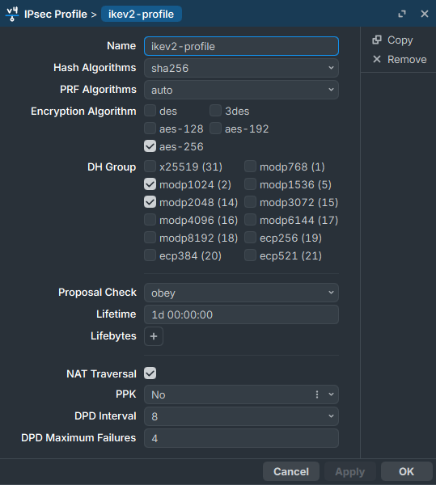

## Create ipsec proposal

```routeros
ip ipsec proposal
add name=ikev2-proposal \
    auth-algorithms=sha256 \
    enc-algorithms=aes-256-cbc \
    pfs-group=none
```

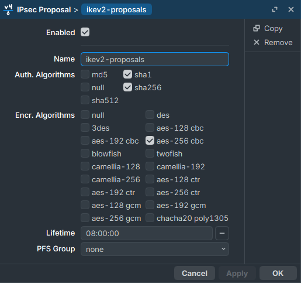

## Create IKEv2 peer

```routeros
/ip ipsec peer
add name=ikev2-peer \
    address=0.0.0.0/0 \
    exchange-mode=ike2 \
    passive=yes \
    profile=ikev2-profile
```

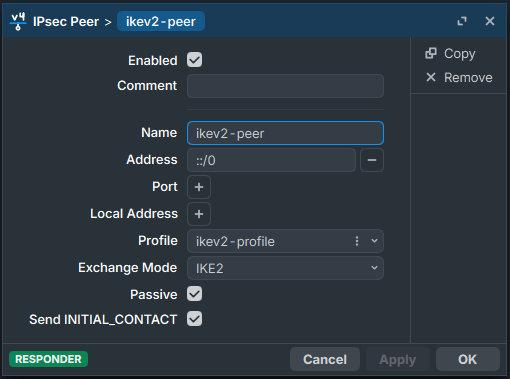

## Create mode-config

```routeros
/ip ipsec mode-config
add name=ikev2-modecfg \
    address-pool=ikev2-pool \
    static-dns=192.168.178.2 \
    address-prefix-length=32
```

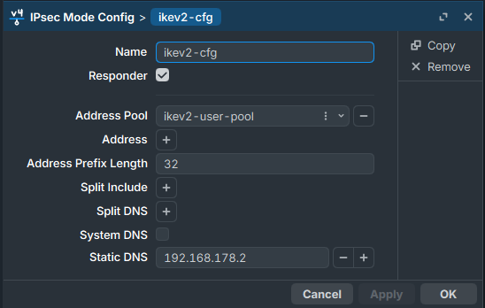

> **Note:**
>
> - Specific local addresses split-include (example:192.168.1.0/24) to allow This means VPN clients can only access this internal LAN.
> - If you want all Internet traffic through MikroTik, don't use split-include like this; use a full-tunnel configuration instead.

## Create IPsec policy group

```routeros
/ip ipsec policy group
add name=ikev2-group
```

## Create IPsec policy template

```routeros
/ip ipsec policy
add group=ikev2-group \
    src-address=0.0.0.0/0 \
    dst-address=0.0.0.0/0 \
    template=yes \
    proposal=ikev2-proposal
```

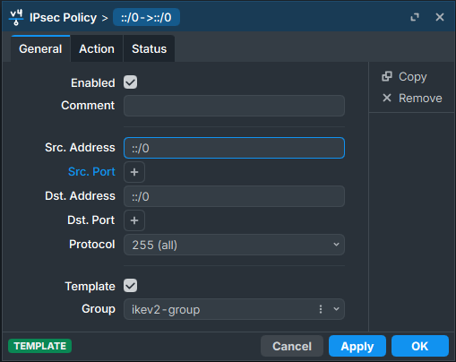
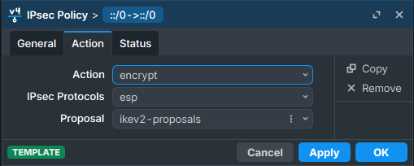

## Create IPsec identity

### User 1

```routeros
/ip ipsec identity
add peer=ikev2-peer \
    auth-method=digital-signature \
    certificate=ikev2-server \
    remote-certificate=chanpiseth-IT-D04 \
    match-by=certificate \
    remote-id=ignore \
    mode-config=ikev2-modecfg \
    generate-policy=port-strict \
    policy-template-group=ikev2-group \
    comment="chanpiseth-IT-D04"
```

### User 2

```routeros
/ip ipsec identity
add peer=ikev2-peer \
    auth-method=digital-signature \
    certificate=ikev2-server \
    remote-certificate=chanpiseth-IT-L06 \
    match-by=certificate \
    remote-id=ignore \
    mode-config=ikev2-modecfg \
    generate-policy=port-strict \
    policy-template-group=ikev2-group \
    comment="chanpiseth-IT-L06"
```

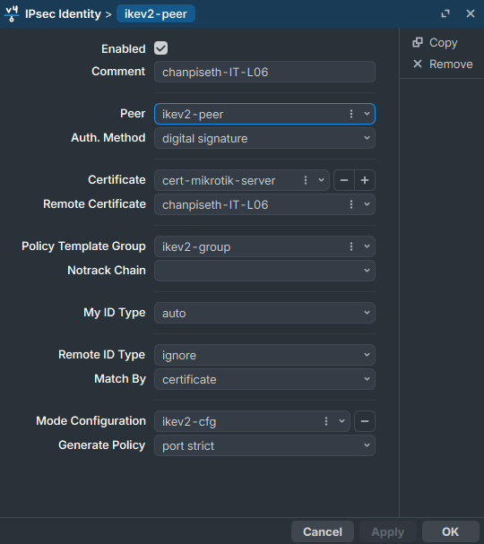

> **Note:**
>
> - if want to disable or remove access from a user by disable the `ipsec identity` and revoke the certificate then remove.
> - To revoke a certificate in MikroTik RouterOS, This marks the certificate as revoked but does not delete it from the system, as issued certificates cannot be permanently removed for security reasons.
> - To effectively remove a all revoke certificate, you must delete its issuing CA (Certificate Authority).  When the CA certificate is removed, all certificates signed by that CA are automatically deleted.
> - If one certificate have leak or compremised disable it certificate `ipsec identity` will block the certificate from authorization the VPN connection.
> - When renew the certificate, you can re-enable the ipsec identity to allow the user to connect again.
> - **`Old certificate` must be removed before install the new ca and user certificate for each users computer. if the old certificate is not expired yet, the new certificate will not work because the old certificate is still valid and will be used for authentication.**

```routeros
/ip ipsec identity disable [find comment="chanpiseth-IT-L06"]
/certificate issued-revoke [find name="chanpiseth-IT-L06"]
/certificate remove [find name="chanpiseth-IT-L06"]
/certificate print
```

## IKEv2 architecture becomes

```markdown
                     MikroTik
                  IKEv2 Server
                       |
              ikev2-peer (ONE)
                       |
        +--------------+--------------+
        |              |              |
      Identity       Identity       Identity
       IT-L06         IT-L07         IT-L08
        |              |              |
     Cert L06       Cert L07       Cert L08
```

## Firewall rule

Firewall rule vpn from internet

```routeros
/ip firewall filter
add chain=input protocol=udp dst-port=500,4500 action=accept \
    comment="IKEv2"
add chain=input protocol=ipsec-esp action=accept \
    comment="IPsec ESP"
add chain=forward ipsec-policy=in,ipsec action=accept
```

## Firewall rule for vpn local access

You should explicitly allow your **IKEv2 VPN pool** `10.250.10.0/24` in the MikroTik firewall.

Your topology is:

```markdown
Windows IKEv2
10.250.10.129
      ↓
MikroTik
      ↓
VLAN 60
192.168.178.0/24
      ↓
SBO
192.168.178.8
```

## 1. Allow VPN → VLAN 60

Put this **above your forward drop rule**:

```routeros
/ip firewall filter
add chain=forward action=accept \
    src-address=10.250.10.0/24 \
    dst-address=192.168.178.0/24 \
    comment="IKEv2 VPN to VLAN60"
```

This allows all VPN users (`10.250.10.1-254`) to access VLAN 60.

## 2. Allow established/related traffic

Make sure you have this near the top of the `forward` chain:

```routeros
/ip firewall filter
add chain=forward action=accept \
    connection-state=established,related \
    comment="Allow established and related"
```

## 3. If you want VPN users to access all internal VLANs

Since you are using full tunnel, you might want VPN users to access your internal networks:

```routeros
/ip firewall filter
add chain=forward action=accept \
    src-address=10.250.10.0/24 \
    dst-address=192.168.0.0/16 \
    comment="IKEv2 VPN to internal networks"
```

**But only use this if you actually want VPN users to access all `192.168.x.x` networks.**

For your current requirement, the narrower VLAN 60 rule is safer.

## 4. DNS

If Windows is querying MikroTik itself for DNS, allow DNS from the VPN pool:

```routeros
/ip firewall filter
add chain=input action=accept \
    src-address=10.250.10.0/24 \
    protocol=udp dst-port=53 \
    comment="IKEv2 VPN DNS UDP"

add chain=input action=accept \
    src-address=10.250.10.0/24 \
    protocol=tcp dst-port=53 \
    comment="IKEv2 VPN DNS TCP"
```

If Windows directly queries `192.168.178.2`, that's forward traffic, so allow:

```routeros
/ip firewall filter
add chain=forward action=accept \
    src-address=10.250.10.0/24 \
    dst-address=192.168.178.2 \
    protocol=udp dst-port=53 \
    comment="IKEv2 VPN to DNS UDP"

add chain=forward action=accept \
    src-address=10.250.10.0/24 \
    dst-address=192.168.178.2 \
    protocol=tcp dst-port=53 \
    comment="IKEv2 VPN to DNS TCP"
```

## 5. Full-tunnel Internet

Because your IKEv2 client uses:

```routeros
split-include=0.0.0.0/0
```

you also need NAT for Internet access:

```routeros
/ip firewall nat
add chain=srcnat \
    src-address=10.250.10.0/24 \
    out-interface-list=WAN \
    action=masquerade \
    comment="IKEv2 VPN Internet"
```

## 6. Important: don't NAT VLAN 60 unless necessary

For your SBO:

10.250.10.129 → 192.168.178.8

I'd first use **routing without NAT**.

If `192.168.178.8` has `192.168.178.1` (MikroTik) as its gateway, the reply can return:

```markdown
192.168.178.8
      ↓
192.168.178.1
      ↓
10.250.10.129
```

No NAT is required.

If the SBO server uses another gateway and cannot route back to `10.250.10.0/24`, then use:

```routeros
/ip firewall nat
add chain=srcnat \
    src-address=10.250.10.0/24 \
    dst-address=192.168.178.0/24 \
    action=masquerade \
    comment="IKEv2 VPN to VLAN60 NAT"
```

**Recommended order:**

Your `forward` chain should roughly have:

```markdown
1. established,related → ACCEPT
2. IKEv2 10.250.10.0/24 → VLAN 60 → ACCEPT
3. IKEv2 10.250.10.0/24 → DNS 192.168.178.2 → ACCEPT
4. other LAN rules
5. final DROP
```

## allow only internal web services

you can restrict the IKEv2 users to only the internal web services you want.

For example, your VPN users are:

```routeros
10.250.10.0/24
```

and your internal network is:

```routeros
192.168.178.0/24
```

If you only want them to access the SBO web server at 192.168.178.8, don't allow the entire VLAN.

**Recommended:**

Allow only HTTP/HTTPS to the SBO server:

```routeros
/ip firewall filter
add chain=forward action=accept \
    src-address=10.250.10.0/24 \
    dst-address=192.168.178.8 \
    protocol=tcp dst-port=80,443 \
    comment="IKEv2 users - SBO Web only"
```

Allow DNS:

```routeros
/ip firewall filter
add chain=forward action=accept \
    src-address=10.250.10.0/24 \
    dst-address=192.168.178.2 \
    protocol=udp dst-port=53 \
    comment="IKEv2 users - DNS"
```

And TCP DNS:

```routeros
/ip firewall filter
add chain=forward action=accept \
    src-address=10.250.10.0/24 \
    dst-address=192.168.178.2 \
    protocol=tcp dst-port=53 \
    comment="IKEv2 users - DNS TCP"
```

Put these above your final drop rule.

Then the VPN users have:

|Destination|Access|
|-|-|
|192.168.178.8:80|✅|
|192.168.178.8:443|✅|
|192.168.178.2:53|✅ DNS|
|Other VLAN 60 devices|❌|
|Other internal servers|❌|
|Internet|Depends on your full-tunnel/NAT rules|

**But there's an important distinction:**

If you keep:

```markdown
split-include=0.0.0.0/0
```

the **Windows client sends all traffic through the VPN**, but that does **not automatically mean the VPN users can access everything**.

The MikroTik firewall decides what they're allowed to reach.

So you can have:

```markdown
Windows
10.250.10.129
      |
      ↓
    VPN
      |
      ↓
MikroTik
   ├── SBO 192.168.178.8:443    ✅
   ├── DNS 192.168.178.2:53     ✅
   ├── Other internal servers   ❌
   └── Other VLAN devices       ❌
```

**One more thing for your SBO hostname:**

Because you're using:

sbo.tem-trading.lan

the DNS server `192.168.178.2` must resolve it to:

```markdown
192.168.178.8
```

So your 10-user IKEv2 VPN can be designed as a restricted-access VPN, rather than giving users unrestricted access to the whole company network.

## Command for check when connect IKEv2 connected

```routeros
/ip ipsec active-peers print detail
/ip ipsec installed-sa print detail
```
